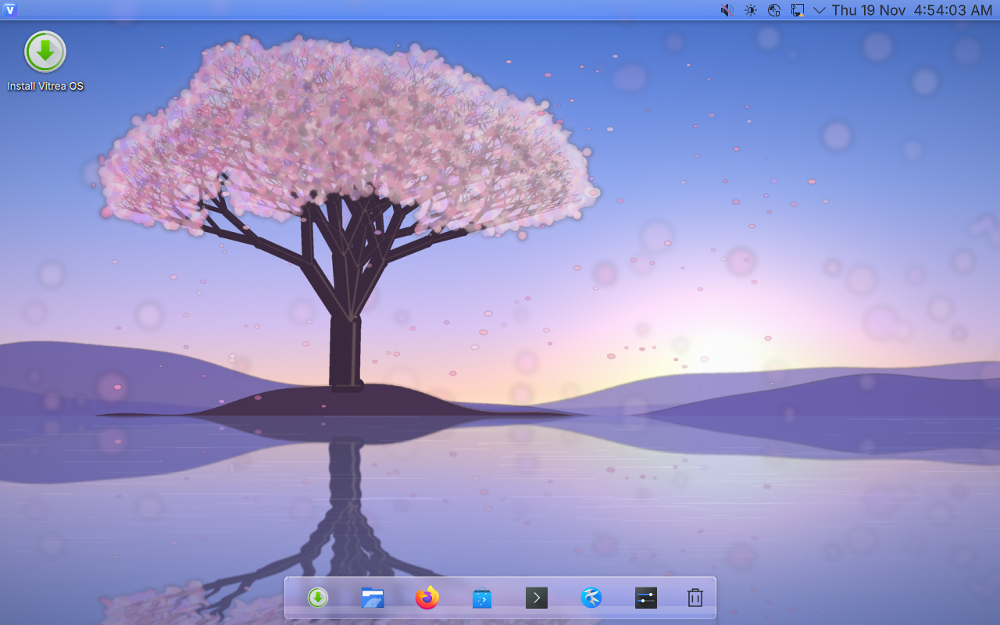
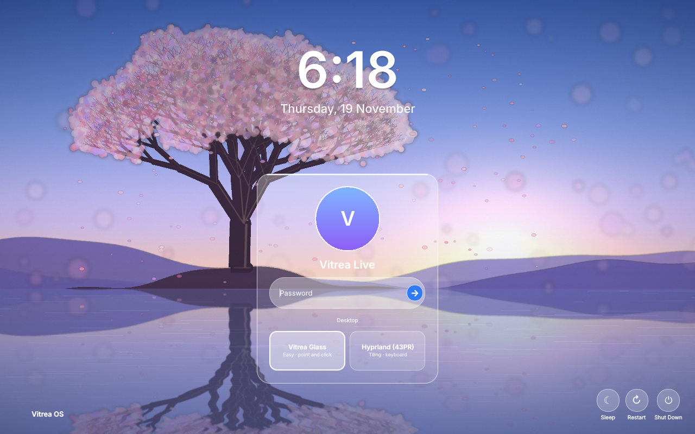
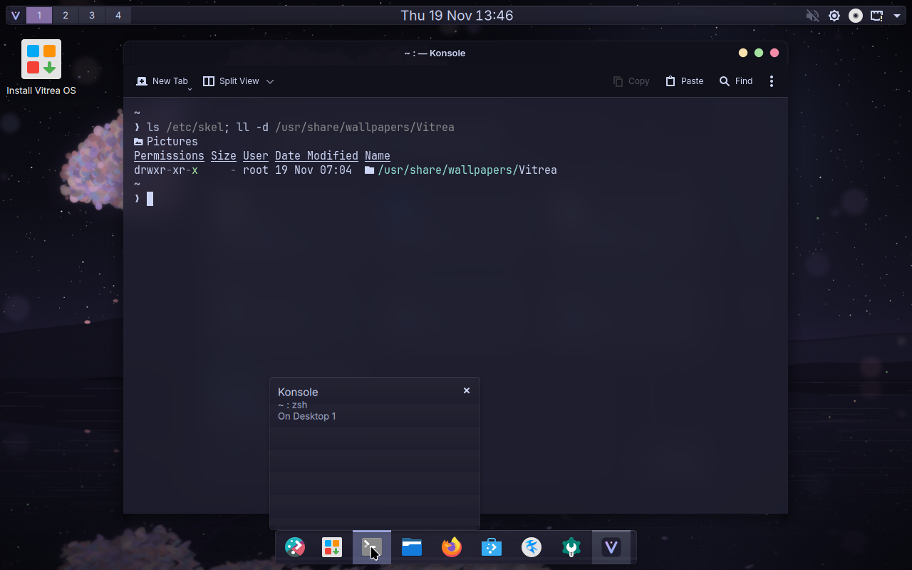
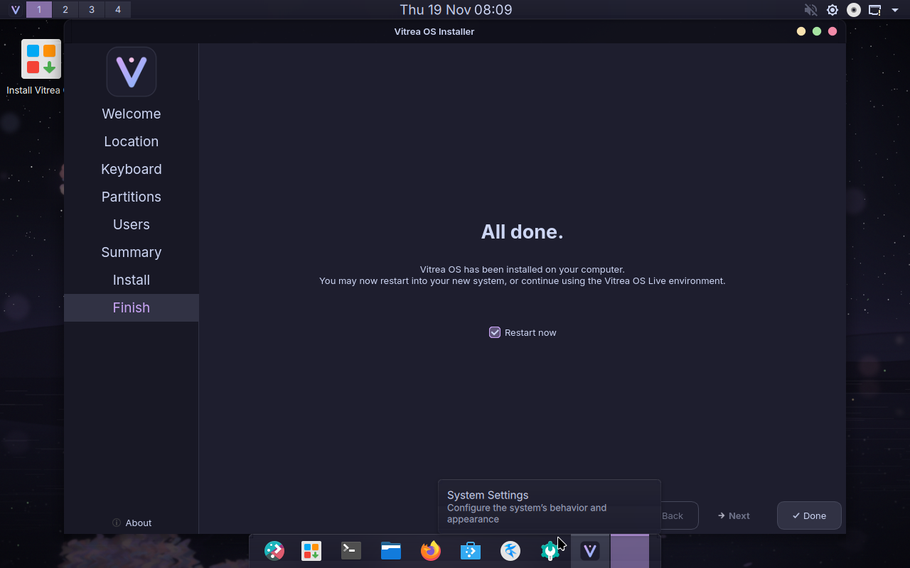
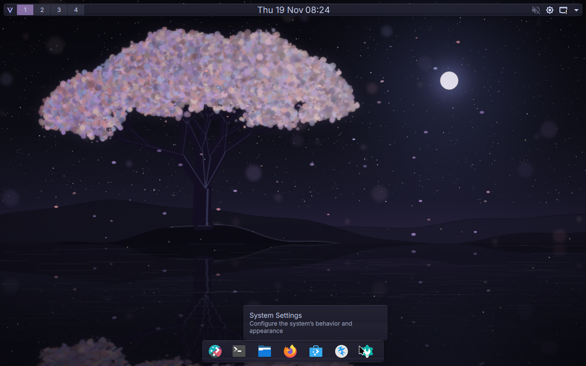

# Vitrea OS

An easy-to-use, Arch-based Linux desktop with a dark, **riced** look ("Vitrea Night"),
plus [43PR's Hyprland dotfiles](https://github.com/43PR/dotfiles) as a second desktop.



## What's new: the Liquid update

Arrives automatically on every Vitrea install (Discover → Updates). No reinstall needed.

* **Real Liquid Glass**: the top bar, dock, menus and popups bend the light behind them
  (refraction), with a specular rim, a soft light that follows your cursor, edge shading and
  rounded "squircle" corners. Powered by the `kwin-effects-glass` KWin effect, which the Vitrea
  repo rebuilds automatically whenever Arch updates KWin. On computers without graphics
  acceleration (most VMs) Vitrea falls back to plain blur so the desktop stays smooth.
* **Glass buttons** across the bar, popups and Vitrea's apps
* **New logo**: the glass V, with no background tile
* **Animated boot splash** ("Vitrea Liquid"): the logo rises out of the night, a halo breathes
  behind it, a comet of light orbits it and petals drift up the screen, with a glass progress bar
  (and a glass password field for encrypted disks). The same scene plays while Plasma loads.
* **New wallpapers**: *Dusk* (a lone tree against a rose sunset, petals torn off by the wind) and
  *Neon* (the same tree in electric cyan)
* **Desktop widgets**: a big *Vitrea Clock* and a *Vitrea Music* card that only appears while
  something is playing
* **Fluid animations**: windows scale in and out, squash into the dock, workspaces slide
* **Vitrea Style** app: Night / Dusk / Neon looks, accent colour, glass strength (clear, liquid,
  frosted) and refraction, animation speed, minimise effect (squash or magic lamp), jelly
  windows, dock position and widgets. Every change applies instantly.
* **Launchpad** in the dock now opens the Overview (all windows + app search); the old dashboard
  widget no longer exists in Plasma 6.8

## Two desktops, picked at the login screen

| | **Plasma — Vitrea Night** (default) | **Hyprland (43PR)** |
|---|---|---|
| Base | KDE Plasma 6 | Hyprland 0.57 + Quickshell |
| Feel | Point-and-click, familiar | Keyboard-driven tiling |
| Look | Dark Catppuccin-style palette everywhere (Plasma, apps, title bars, Konsole, login, splash, installer), slim floating top bar with numbered workspaces and a centred clock, minimal floating dock with a Launchpad grid, flat title bars with coloured dot buttons on the right, Papirus-Dark icons, JetBrains Mono Nerd Font terminal, moody night "blossom tree" wallpaper | 43PR's bar, settings, wallpaper picker and matugen colour themes, unchanged |
| Good for | Everyone | Ricers and power users |

Both share the same apps and home folder. In the live session, open **Welcome → Try Hyprland**
(or log out) and pick **Hyprland (43PR)** in the session menu at the bottom-left of the login screen.

## From power button to desktop

* **Boot splash:** Vitrea logo on a dark gradient (Plymouth), also on installed systems; handles disk-encryption passwords
* **Login screen:** custom dark SDDM theme — big mono clock over the night tree, login card, and two big
  "desktop" chips to pick **Plasma** or **Hyprland (43PR)** (no hunting for a tiny session menu)
* **Windows:** flat dark title bars with rounded corners, soft shadow and red/yellow/green dot buttons
* **Launchpad:** a full-screen app grid on the left of the dock





## Easy by default

* Boots straight into a live desktop with no password; nothing changes until you install
* **Install Vitrea OS** icon on the desktop and in the dock opens a guided graphical installer (Calamares)
* **Welcome** app on first login: Install, Get Apps, Wi-Fi, Displays, Updates, Light/Dark mode
* **Discover** app store with Flathub; Firefox, LibreOffice-ready, media player and the KDE app set
* Wi-Fi, Bluetooth, printing, PipeWire audio, firmware updates, compressed RAM swap (zram)
* New users get zsh + starship + eza (from the 43PR dotfiles)

## Try it

Write the ISO to a USB stick (Ventoy, balenaEtcher, Rufus in DD mode, or `dd`), or boot it in a VM
(2+ CPUs, 4 GB+ RAM, 3D acceleration on).

```bash
sudo dd if=vitrea-os-*.iso of=/dev/sdX bs=4M status=progress oflag=sync
```

**Secure Boot:** like Arch Linux itself, the ISO isn't signed, so turn Secure Boot off in
your firmware settings.

## Build it

On Arch (or inside an Arch container), as root:

```bash
sudo pacman -S --needed archiso base-devel git
sudo ./build.sh          # standard edition
sudo ./build.sh --t2     # T2 Mac edition (see below)
```

| Path | What it is |
|---|---|
| `archiso/` | the archiso profile (based on Arch's official `releng`) |
| `archiso/packages.x86_64` | every package on the ISO |
| `archiso/airootfs/` | live-session and installer files: installer config, live user setup, 43PR dotfiles in `/etc/skel` |
| `pkgbuilds/vitrea-desktop/` | Vitrea's look, apps and settings as an updatable package (see *Pushing updates*) |
| `pkgbuilds/vitrea-t2/` | T2 Mac support as an updatable package |
| `archiso/airootfs/usr/local/bin/vitrea-customize` | one-time build step: locale, services, live initramfs |
| `pkgbuilds/vitrea-desktop/files/usr/lib/vitrea/make-glass-theme.py` | tints Plasma's Breeze panel/popup frames to the dark Vitrea Night palette (re-run by a pacman hook after Plasma updates) |
| `archiso/airootfs/etc/calamares/` | installer configuration and branding |
| `pkgbuilds/` | local builds of the AUR packages: calamares, mpvpaper, papirus-folders, ttf-tabler-icons |
| `art/` | generators for the night blossom tree wallpaper (`make_tree.py`), the Vitrea Night palette for Plasma and Konsole (`make_night.py`), window decorations (`make_decoration.py`), logo and installer slides |
| `pkgbuilds/vitrea-desktop/files/usr/share/sddm/themes/vitrea/` | the login screen (QML); preview it with `tools/preview-sddm.py` |
| `t2/` | the T2 Mac edition: package swaps and `make-profile.sh`, which derives its profile from `archiso/` |
| `tools/` | QEMU boot test with screenshots (`test-boot.sh`), plus helpers to type into and screenshot the VM |

### Updating the 43PR dotfiles

They're copied into `archiso/airootfs/etc/skel/` (commit recorded in
`/usr/share/doc/43pr-dotfiles/COMMIT`). To update, re-copy `.config/` from the repo
(`.config/.zshrc` goes to `etc/skel/.zshrc`) and rebuild. Two small changes were made to them:
the browser is `firefox` instead of `brave` (Brave is AUR-only), and the `eza` aliases use
`--icons=auto` (with current eza a bare `--icons` swallows the next argument, so `ls some/dir` failed).

## T2 Macs (2018–2020 Intel Macs, including the 2019 Mac Pro)

Use the **T2 edition** (`vitrea-os-t2-*.iso`, built with `sudo ./build.sh --t2`). It's the same
Vitrea, plus the [t2linux](https://wiki.t2linux.org) support:

| | What the T2 edition does |
|---|---|
| Kernel | `linux-t2` (from the t2linux `arch-mact2` repo, kept for updates) with the `t2bce` driver: built-in keyboard, trackpad, Touch Bar, camera and **audio** all go through the T2 chip |
| Boot options | `intel_iommu=on iommu=pt pm_async=off`, as t2linux recommends, on the USB stick and the installed system |
| Audio | `apple-t2-audio-config` speaker/mic profiles for PipeWire |
| Wi-Fi + Bluetooth | Apple's firmware can't be shipped, so Vitrea **copies it from macOS** (read-only) on first boot when macOS is on the internal drive, and the installer carries it over to the new system. Retry any time with **Welcome → Mac Wi-Fi Setup**. Wi-Fi uses `iwd` (Broadcom chips fail with current `wpa_supplicant`) |
| Fans | `t2fanrd` fan daemon (curve in `/etc/t2fand.conf`) |
| Touch Bar | `tiny-dfr` (function/media keys) on MacBooks that have one |
| Mac Pro / iMac Pro GPUs | AMD GPUs are pinned to their "high" power level, t2linux's workaround for crashes on mode changes (`/etc/udev/rules.d/80-vitrea-mac-amdgpu.rules`; delete it to go back to automatic) |

### Installing on a T2 Mac

1. **In macOS** (keep it if you can: it's where the Wi-Fi firmware comes from):
   restart holding **⌘R** → *Utilities → Startup Security Utility* → Secure Boot: **No Security**,
   and **Allow booting from external or removable media**.
2. To keep macOS, make room first: *Disk Utility → Partition → Add Partition* (any format; the
   installer reformats it).
3. Write the T2 ISO to a USB stick, restart holding **⌥ Option**, pick the orange **EFI Boot**.
4. In the installer, choose **Manual partitioning** if you're keeping macOS: format your new
   partition as ext4 mounted at `/`, and use the existing EFI partition at `/boot/efi`
   **without formatting it**. *Erase disk* removes macOS (and with it the Wi-Fi firmware source,
   unless the live session already copied it: check that Wi-Fi works before installing).
5. Afterwards, hold **⌥ Option** at startup to choose between macOS and **EFI Boot** (Vitrea).

**2019 Mac Pro notes:** use a USB or Bluetooth-paired keyboard/mouse (it has no built-in ones).
The two 10 Gb Ethernet ports work without any firmware, so you're online right away.
t2linux reports PCIe address-space problems on some Mac Pro configurations, mainly with
**Infinity Fabric Link** bridges between MPX GPUs; if the system fails to boot or a GPU is missing,
removing the bridge is the known workaround. The Afterburner card has no Linux driver.

> The T2 edition is built and boot-tested in a VM, which can't emulate the T2 chip. Keyboard,
> audio, Wi-Fi, fans and the Mac Pro GPUs need a real Mac to confirm; please report what works.
> The t2linux packages are unsigned (`SigLevel = Never`, as in t2linux's own setup).

## Pushing updates (no reinstall)

Installed Vitrea systems update like any Arch system: **Discover → Updates** (or
`sudo pacman -Syu`) brings Arch's updates *and* Vitrea's own, from the **Vitrea repo** that
every install has in `/etc/pacman.conf`:

```ini
[vitrea]
Server = https://github.com/jnorrish42-ai/vitrea-os/releases/download/repo
```

To ship a change:

1. Edit Vitrea's files in **`pkgbuilds/vitrea-desktop/files/`** (theme, Welcome app, login
   screen, wallpapers, Plasma defaults in `etc/xdg/`, …) or **`pkgbuilds/vitrea-t2/files/`**
   (T2 Mac support). The folders mirror where the files go on the system.
2. Commit and push to `main`.
3. The **Publish Vitrea updates** workflow (GitHub → Actions) builds both packages with a new
   version number and publishes them to the `repo` release. A few minutes later every Vitrea
   install sees the update.

After updating, `vitrea-apply` re-runs on each machine: it regenerates the colour schemes, the
glass Plasma theme and the boot splash (rebuilding the boot image only if the splash changed).
System-wide defaults (`/etc/xdg`) apply to everyone who hasn't changed that setting themselves;
files copied into people's home folders at account creation (`/etc/skel`, e.g. the 43PR
dotfiles) only affect new accounts.

The repo is unsigned (`SigLevel = Optional TrustAll`), so anyone who can push to `main` can
ship updates to every Vitrea install. Keep write access to this GitHub repo to yourself.

## Status and known limitations

Tested end to end in QEMU (UEFI, software rendering, 40 GB virtual disk):

* ✅ Live boot: Vitrea splash → riced desktop with auto-login, Welcome app, night tree wallpaper
* ✅ **Full install with the graphical installer** (erase disk, ext4) completes: "All done."
* ✅ Installed system boots: splash → Vitrea login screen → riced desktop as the new user
* ✅ After install: user in `wheel` with zsh + starship, root locked, installer and live user removed,
  Plymouth in the initramfs, no failed services
* ✅ 43PR Hyprland session starts (Hyprland 0.57 + Quickshell bar, colours generated from the wallpaper)
* ⚠️ In VMs without 3D acceleration, window shadows can render as pale rectangles and Hyprland's
  wallpaper may not show; enable 3D acceleration (or use real hardware)
* ⚠️ QEMU *without KVM* (pure software CPU emulation): use `-cpu SandyBridge`, not `-cpu max`.
  QEMU 8's emulated AVX2 crashes the software renderer partway through an install
  (`tools/test-boot.sh` does this for you). Real hardware and KVM VMs are unaffected.
* ⚠️ Secure Boot must be disabled (unsigned, like the Arch ISO); on T2 Macs see the steps above

| Installer finished | Installed system, first login |
|---|---|
|  |  |

## Credits

* Arch Linux, KDE Plasma, Hyprland, Quickshell, Calamares
* **t2linux** (linux-t2 kernel, t2bce, audio config, firmware fetcher, t2fanrd, tiny-dfr) for the T2 Mac edition
* **43PR/dotfiles** by 43PR (MIT): Hyprland/Quickshell desktop, zsh, kitty, rofi, theming
* Glass Kvantum styles derived from Tsu Jan's KvMojave (GPLv3)
* Vitrea logo, wallpapers and installer slides: original

Not affiliated with Arch Linux, KDE, 43PR or Apple.
