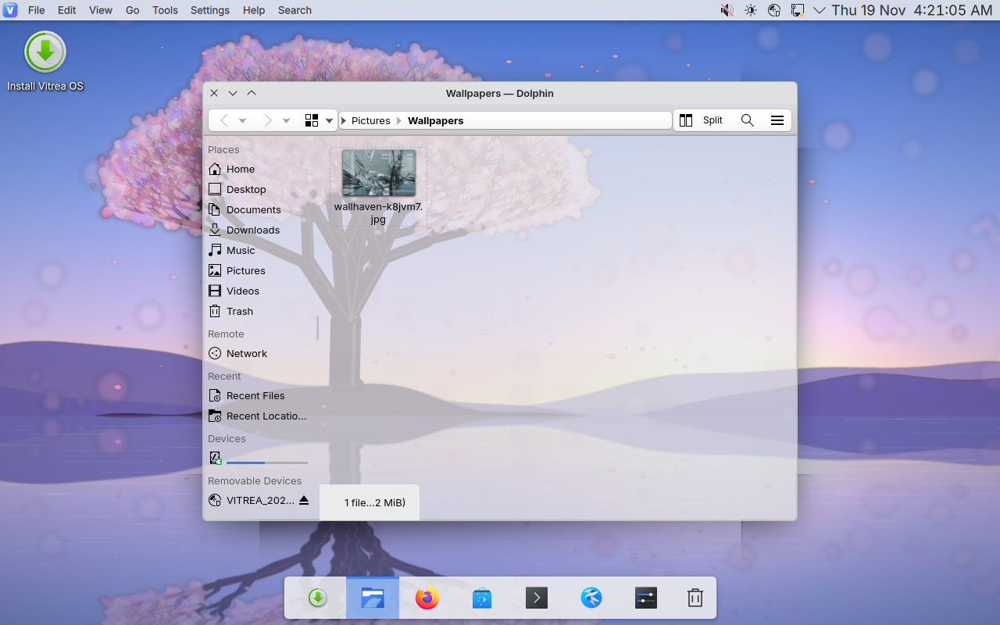

# Vitrea OS

An easy-to-use, Arch-based Linux desktop with a dark, **riced** look ("Vitrea Night"),
plus [43PR's Hyprland dotfiles](https://github.com/43PR/dotfiles) as a second desktop.



## Two desktops, picked at the login screen

| | **Plasma — Vitrea Night** (default) | **Hyprland (43PR)** |
|---|---|---|
| Base | KDE Plasma 6 | Hyprland 0.57 + Quickshell |
| Feel | Point-and-click, familiar | Keyboard-driven tiling |
| Look | Dark Catppuccin-style palette everywhere (Plasma, apps, title bars, Konsole, login, splash, installer), slim floating top bar with numbered workspaces and a centred clock, minimal floating dock with a Launchpad grid, flat title bars with coloured dot buttons on the right, Papirus-Dark icons, JetBrains Mono Nerd Font terminal, moody night "blossom tree" wallpaper | 43PR's bar, settings, wallpaper picker and matugen colour themes, unchanged |
| Good for | Everyone | Ricers and power users |

Both share the same apps and home folder. In the live session, open **Welcome → Try Hyprland**
(or log out) and pick **Hyprland (43PR)** in the session menu at the bottom-left of the login screen.

## From power button to desktop

* **Boot splash:** Vitrea logo on a dark gradient (Plymouth), also on installed systems; handles disk-encryption passwords
* **Login screen:** custom dark SDDM theme — big mono clock over the night tree, login card, and two big
  "desktop" chips to pick **Plasma** or **Hyprland (43PR)** (no hunting for a tiny session menu)
* **Windows:** flat dark title bars with rounded corners, soft shadow and red/yellow/green dot buttons
* **Launchpad:** a full-screen app grid on the left of the dock


## Easy by default

* Boots straight into a live desktop with no password; nothing changes until you install
* **Install Vitrea OS** icon on the desktop and in the dock opens a guided graphical installer (Calamares)
* **Welcome** app on first login: Install, Get Apps, Wi-Fi, Displays, Updates, Light/Dark mode
* **Discover** app store with Flathub; Firefox, LibreOffice-ready, media player and the KDE app set
* Wi-Fi, Bluetooth, printing, PipeWire audio, firmware updates, compressed RAM swap (zram)
* New users get zsh + starship + eza (from the 43PR dotfiles)

## Try it

Write the ISO to a USB stick (Ventoy, balenaEtcher, Rufus in DD mode, or `dd`), or boot it in a VM
(2+ CPUs, 4 GB+ RAM, 3D acceleration on).

```bash
sudo dd if=vitrea-os-*.iso of=/dev/sdX bs=4M status=progress oflag=sync
```

**Secure Boot:** like Arch Linux itself, the ISO isn't signed, so turn Secure Boot off in
your firmware settings.

## Build it

On Arch (or inside an Arch container), as root:

```bash
sudo pacman -S --needed archiso base-devel git
sudo ./build.sh
```

| Path | What it is |
|---|---|
| `archiso/` | the archiso profile (based on Arch's official `releng`) |
| `archiso/packages.x86_64` | every package on the ISO |
| `archiso/airootfs/` | files placed into the OS: themes, layout, Welcome app, installer config, 43PR dotfiles in `/etc/skel` |
| `archiso/airootfs/usr/local/bin/vitrea-customize` | one-time build step: branding, colour schemes, services |
| `archiso/airootfs/usr/lib/vitrea/make-glass-theme.py` | turns Plasma's Breeze frames into Liquid Glass (re-run by a pacman hook after Plasma updates) |
| `archiso/airootfs/etc/calamares/` | installer configuration and branding |
| `pkgbuilds/` | local builds of the AUR packages: calamares, mpvpaper, papirus-folders, ttf-tabler-icons |
| `art/` | generators for the Glass Blossom tree wallpaper (`make_tree.py`), glass window decorations (`make_decoration.py`), the liquid gradient, logo and installer slides |
| `archiso/airootfs/usr/share/sddm/themes/vitrea/` | the Liquid Glass login screen (QML); preview it with `tools/preview-sddm.py` |
| `tools/` | QEMU boot test with screenshots (`test-boot.sh`), plus helpers to type into and screenshot the VM |

### Updating the 43PR dotfiles

They're copied into `archiso/airootfs/etc/skel/` (commit recorded in
`/usr/share/doc/43pr-dotfiles/COMMIT`). To update, re-copy `.config/` from the repo
(`.config/.zshrc` goes to `etc/skel/.zshrc`) and rebuild. The only change made to them:
the browser is `firefox` instead of `brave` (Brave is AUR-only).

## Status and known limitations

Tested by booting the ISO (UEFI) in QEMU with software rendering:

* ✅ Boots to the live Vitrea Glass desktop with auto-login, Welcome app, tree wallpaper, Liquid Glass bar/dock
* ✅ Installer starts and shows its pages; DNS, NetworkManager, Flathub, SDDM all working
* ✅ 43PR Hyprland session starts (Hyprland 0.57 + Quickshell bar, colours generated from the wallpaper)
* ⚠️ A full install to disk has **not** been run end-to-end yet; try it in a VM before real hardware
* ⚠️ In VMs without 3D acceleration, window shadows can render as pale rectangles and Hyprland's
  wallpaper may not show; enable 3D acceleration (or use real hardware)
* ⚠️ Secure Boot must be disabled (unsigned, like the Arch ISO)

## Credits

* Arch Linux, KDE Plasma, Hyprland, Quickshell, Calamares
* **43PR/dotfiles** by 43PR (MIT): Hyprland/Quickshell desktop, zsh, kitty, rofi, theming
* Glass Kvantum styles derived from Tsu Jan's KvMojave (GPLv3)
* Vitrea logo, wallpapers and installer slides: original

Not affiliated with Arch Linux, KDE, 43PR or Apple.
